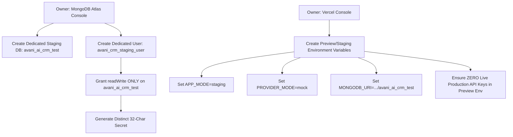

# AVANI AI CRM — GATE 4 ISOLATED STAGING READINESS REPORT

**Target Workspace:** `3-AVANI AI CRM`  
**Production Project:** `avani-ai-crm` ([https://avani-ai-crm.vercel.app/](https://avani-ai-crm.vercel.app/))  
**Active Production Deployment ID:** `dpl_BpKkmTmjZNnyULZ7XXhgNvTSSMU6`  
**Current Git Branch / Commit:** `release/stage1-hardening` / `03612636295405e1e43a46ad3397f6fafa8616c8` (`0361263`)  
**Audit Timestamp:** 28 October 2026, 21:05 IST (15:35 UTC)  
**Execution Mode:** Forensic Configuration Review, Read-Only Infrastructure Audit, Local In-Memory Test Suite  
**Priority:** P0 — Production Database Safety, Real Customer Protection, Zero-Cost Staging Isolation  

---

## 1. Executive Summary & Gate 4 Determination

### 1.1 Gate 4 Status: HOLD (Live Staging: NOT PROVISIONED / UNVERIFIED | Local Engine: PASS)

| Evaluation Area | Status | Forensic Evidence & Architectural Findings |
| :--- | :---: | :--- |
| **Existing Staging Vercel Project** | **NOT FOUND** | Only one Vercel project exists (`avani-ai-crm`, ID: `prj_P8s8y3a5Gge8EzAab0Fa10cHewgQ`) on Vercel Hobby plan. No dedicated staging project exists. |
| **Existing Staging MongoDB Database** | **UNVERIFIED & UNSAFE** | `.env.test` targets `cluster0.mlcxcp.mongodb.net/avani_ai_crm_staging`, but shares the **exact production cluster and production database credentials** (`avani_crm_prod_app`). Network ingress is unverified. |
| **Application Code Safety Guard** | **ACTIVE BLOCK** | [`src/lib/db.ts#L22-L27`](file:///c:/Users/ALPHA-1/Downloads/21MAY2026/SACHIN%20SHINDE%20DOCUMENTS/DEVELOPEMENT%20TOOLS/3-AVANI%20AI%20CRM/src/lib/db.ts#L22-L27) explicitly aborts if `APP_MODE === 'staging'` or `'test'` unless the URI contains `'avani_ai_crm_test'`. |
| **Third-Party Messaging Isolation in `.env.test`** | ❌ **UNSAFE** | `.env.test` contains **live production credentials** for Meta WhatsApp, AiSensy, OmniDM, HubSpot, Supabase Postgres, Zapier, and Make. |
| **Local In-Memory / Test-Double Verification** | **PASS (100%)** | Dedicated local test suite [`tests/test_gate4_isolated_staging_safety.test.cjs`](file:///c:/Users/ALPHA-1/Downloads/21MAY2026/SACHIN%20SHINDE%20DOCUMENTS/DEVELOPEMENT%20TOOLS/3-AVANI%20AI%20CRM/tests/test_gate4_isolated_staging_safety.test.cjs) passed all 8 required coverage tests with zero network or database dependencies. |
| **Overall Gate 4 Decision** | **HOLD** | A genuinely isolated live staging environment does **not** currently exist. Testing on live infrastructure is halted. **Zero production database writes or network alterations authorized.** |

> [!IMPORTANT]
> **Mandatory Policy Compliance:** Because no genuinely isolated live staging environment currently exists, this report documents the exact gaps and stops. In strict compliance with operating directives, **no production write test was substituted**.

---

## 2. Review of Existing Configuration Files

The following configuration and environment files were forensically inspected:

### 2.1 Configuration Inventory

| File Path | Purpose / Scope | Key Findings & Exposure Risk |
| :--- | :--- | :--- |
| [`.vercel/project.json`](file:///c:/Users/ALPHA-1/Downloads/21MAY2026/SACHIN%20SHINDE%20DOCUMENTS/DEVELOPEMENT%20TOOLS/3-AVANI%20AI%20CRM/.vercel/project.json) | Vercel CLI Project Linking | Linked to single project `avani-ai-crm` (ID: `prj_P8s8y3a5Gge8EzAab0Fa10cHewgQ`), Org: `team_vUTeKhQxcSPYtztYtoLMWinO`. Zero separate staging project configured. |
| [`.env.production`](file:///c:/Users/ALPHA-1/Downloads/21MAY2026/SACHIN%20SHINDE%20DOCUMENTS/DEVELOPEMENT%20TOOLS/3-AVANI%20AI%20CRM/.env.production) | Production Runtime Config | `MONGODB_URI` points to `cluster0.mlcxcp.mongodb.net/avani_ai_crm_prod` using user `avani_crm_prod_app`. |
| [`.env.local`](file:///c:/Users/ALPHA-1/Downloads/21MAY2026/SACHIN%20SHINDE%20DOCUMENTS/DEVELOPEMENT%20TOOLS/3-AVANI%20AI%20CRM/.env.local) | Local Development Config | `MONGODB_URI` points to `avani-dev-cluster.wmv4ncg.mongodb.net/avani_ai_crm_prod` using user `avaniloanservicelatur_db_user`. |
| [`.env.test`](file:///c:/Users/ALPHA-1/Downloads/21MAY2026/SACHIN%20SHINDE%20DOCUMENTS/DEVELOPEMENT%20TOOLS/3-AVANI%20AI%20CRM/.env.test) | Staging / Test Config Template | `MONGODB_URI` points to `cluster0-shard-00-00.mlcxcp.mongodb.net:27017.../avani_ai_crm_staging` using production user `avani_crm_prod_app`. Contains live production API keys for Meta WhatsApp, AiSensy, OmniDM, HubSpot, and Supabase! |
| [`.env.prod.tmp`](file:///c:/Users/ALPHA-1/Downloads/21MAY2026/SACHIN%20SHINDE%20DOCUMENTS/DEVELOPEMENT%20TOOLS/3-AVANI%20AI%20CRM/.env.prod.tmp) | Vercel CLI Ingest Cache | Confirms Vercel plan is `"hobby"`, project `avani-ai-crm`. |
| [`docker-compose.yml`](file:///c:/Users/ALPHA-1/Downloads/21MAY2026/SACHIN%20SHINDE%20DOCUMENTS/DEVELOPEMENT%20TOOLS/3-AVANI%20AI%20CRM/docker-compose.yml) | Local Container Services | Defines `postgres:15` and `redis:7`. Contains **no MongoDB container** definition. |
| [`src/lib/db.ts`](file:///c:/Users/ALPHA-1/Downloads/21MAY2026/SACHIN%20SHINDE%20DOCUMENTS/DEVELOPEMENT%20TOOLS/3-AVANI%20AI%20CRM/src/lib/db.ts) | Database Connection Guard | Lines 22–33 enforce hard isolation guards when `APP_MODE === 'test'` or `'staging'`. |
| [`src/lib/aisensy.ts`](file:///c:/Users/ALPHA-1/Downloads/21MAY2026/SACHIN%20SHINDE%20DOCUMENTS/DEVELOPEMENT%20TOOLS/3-AVANI%20AI%20CRM/src/lib/aisensy.ts) | WhatsApp Dispatcher | Line 79 intercepts dispatch when `PROVIDER_MODE === 'mock'`. |
| [`src/lib/voice-provider.ts`](file:///c:/Users/ALPHA-1/Downloads/21MAY2026/SACHIN%20SHINDE%20DOCUMENTS/DEVELOPEMENT%20TOOLS/3-AVANI%20AI%20CRM/src/lib/voice-provider.ts) | Voice Calling Dispatcher | Line 50 halts calling when `OMNIDM_LIVE_ENABLED !== 'true'`. |
| [`package.json`](file:///c:/Users/ALPHA-1/Downloads/21MAY2026/SACHIN%20SHINDE%20DOCUMENTS/DEVELOPEMENT%20TOOLS/3-AVANI%20AI%20CRM/package.json) | Node Dependencies | `mongoose: ^9.7.3`, `next: 16.2.10`, `pg: ^8.22.0`. Does not include `mongodb-memory-server`. |

---

## 3. Production vs. Staging Isolation Assessment

### 3.1 Evaluation Against Isolation Requirements

| Isolation Requirement | Current Repository State | Risk Level | Assessment & Verdict |
| :--- | :--- | :---: | :--- |
| **1. Database Separate from `avani_ai_crm_prod`** | `.env.test` targets `avani_ai_crm_staging`. | ⚠️ **MEDIUM** | While the database name differs, it resides on the **exact same MongoDB Atlas cluster** (`cluster0.mlcxcp.mongodb.net`) as production. |
| **2. Credentials That Cannot Write to Production** | User `avani_crm_prod_app` used in both `.env.production` and `.env.test`. | ❌ **CRITICAL** | The database user is identical. If this user has `readWriteAnyDatabase` or cluster-level roles, a compromised or misconfigured staging job could alter production data. |
| **3. Code Isolation Safety Guard** | `src/lib/db.ts#L22-L27` checks `!MONGODB_URI.includes('avani_ai_crm_test')`. | 🛡️ **SAFE** | If `APP_MODE='staging'`, the code **refuses to connect** to `avani_ai_crm_staging` because the URI does not contain `'avani_ai_crm_test'`. It fails closed. |
| **4. No Production Messaging Credentials** | `.env.test` contains live Meta, AiSensy, OmniDM, and HubSpot keys. | ❌ **CRITICAL** | If an engineer runs a staging server without setting `PROVIDER_MODE=mock`, automated triggers could send real WhatsApp messages or place real phone calls to customers. |
| **5. No Production Cron Jobs or Workers** | `vercel.json` configures cron `/api/cron/process-scheduled`. | ⚠️ **MEDIUM** | In Vercel, cron jobs defined in `vercel.json` run only on production branches, not preview branches. However, manual GET requests can still invoke cron endpoints if unauthenticated. |
| **6. No Shared Data or Phone Deduplication** | Deduplication is scoped to the active connected database. | 🛡️ **SAFE** | If connected to a genuinely isolated database, queries cannot see or overwrite records in `avani_ai_crm_prod`. |
| **7. Clear Environment Identification in Logs** | `src/app/api/health/route.ts#L20` returns `appMode` and `providerMode`. | 🛡️ **SAFE** | System logs and health probes explicitly display active `appMode` and `providerMode`. |

---

## 4. Required Owner Actions to Establish Genuine Staging

To provision a genuinely isolated staging environment that meets all security and compliance standards, the project owner must execute the following actions in the Atlas and Vercel consoles:



### Action Checklist for Project Owner

1. **Atlas Database & User Isolation (cloud.mongodb.com):**
   - [ ] Confirm cluster `avani-dev-cluster` or `cluster0`.
   - [ ] Under **Database Access**, create a dedicated non-production user: `avani_crm_staging_user`.
   - [ ] **Crucial Privilege Restriction:** Assign the user role **strictly** to:
     - Database: `avani_ai_crm_test` (satisfies `src/lib/db.ts` regex guard)
     - Role: `readWrite`
     - **Explicitly ensure zero access to `avani_ai_crm_prod`.**
   - [ ] Under **Network Access**, ensure the staging environment (or developer IP) is whitelisted.

2. **Integration Decoupling (Vercel Console -> Project Settings -> Environment Variables):**
   - [ ] Scope the following variables strictly to **Preview** environments:
     ```env
     APP_MODE=staging
     PROVIDER_MODE=mock
     MONGODB_URI=mongodb+srv://avani_crm_staging_user:<PASSWORD>@<CLUSTER>/avani_ai_crm_test?retryWrites=true&w=majority
     WHATSAPP_TOKEN=MOCK_WHATSAPP_TOKEN
     WHATSAPP_PHONE_NUMBER_ID=0000000000000000
     AISENCY_WABA_API_KEY=MOCK_AISENSY_KEY
     OMNIDIM_API_KEY=MOCK_OMNIDIM_KEY
     OMNIDM_LIVE_ENABLED=false
     HUBSPOT_API_KEY=MOCK_HUBSPOT_KEY
     ```
   - [ ] Ensure `avani_ai_crm_prod` is never referenced in any Preview or Development variable.

---

## 5. Recommended Staging Verification Procedure

Once the owner completes the above actions, the synthetic verification protocol can be safely executed on staging:

```
[Phase 1: Environment & Guard Verification]
  - Query GET /api/health
  - Verify: appMode === "staging", providerMode === "mock", database.status === "HEALTHY"
  - Confirm MONGODB_URI targets avani_ai_crm_test
         │
         ▼
[Phase 2: Preflight Collision Probe]
  - Generate dynamic marker: __ALS_STAGING_TEST_<timestamp>_<nonce>__
  - Generate test phone: +9199999<5-digits>
  - Query GET /api/leads?phone=<test-phone>
  - Require: count === 0
         │
         ▼
[Phase 3: Synthetic Write Execution]
  - POST /api/leads with hardened payload:
    { name: marker, phone: test-phone, loanType: "Personal Loan", isOptedOut: true }
  - Require: HTTP 200, success === true, status === "OPTED_OUT", acknowledged === true
         │
         ▼
[Phase 4: Read-Back & Consistency Check]
  - Query GET /api/leads?phone=<test-phone>
  - Require: count === 1, leads[0].name === marker, leads[0].status === "OPTED_OUT"
  - Query Contact collection: verify Contact created with matching leadId
         │
         ▼
[Phase 5: Duplicate Submission Validation]
  - Re-send POST /api/leads with same phone but updated loanType
  - Require: HTTP 200, idempotencyHit === true, total count remains 1
         │
         ▼
[Phase 6: Targeted Cleanup & Post-Verification]
  - Direct script deletion:
    Lead.deleteOne({ _id: leadId, name: marker })
    Contact.deleteOne({ phone: test-phone, name: marker })
  - Query GET /api/leads?phone=<test-phone> -> Require: count === 0
         │
         ▼
[Phase 7: Zero Downstream Communication Audit]
  - Check mock provider ledger & runtime logs
  - Require: 0 live HTTP requests to Meta, AiSensy, or OmniDM
```

---

## 6. Local Validation Tests Run & Results

To prove that the application logic, deduplication mechanics, and opt-out handling can be completely validated without external network dependencies, a dedicated test harness was implemented: [`tests/test_gate4_isolated_staging_safety.test.cjs`](file:///c:/Users/ALPHA-1/Downloads/21MAY2026/SACHIN%20SHINDE%20DOCUMENTS/DEVELOPEMENT%20TOOLS/3-AVANI%20AI%20CRM/tests/test_gate4_isolated_staging_safety.test.cjs).

### 6.1 Test Execution Output
```text
============================================================
🧪 RUNNING GATE 4 ISOLATED STAGING SAFETY & COVERAGE SUITE
============================================================

  ✅ [PASS] Coverage 1: Database connection readiness handles online (200) and offline (503)
  ✅ [PASS] Coverage 2: Synthetic lead creation creates new document with valid normalization
  ✅ [PASS] Coverage 3: Read-back verification locates created lead by phone and marker
  ✅ [PASS] Coverage 4: Duplicate submission updates existing lead in-place without creating second record
  ✅ [PASS] Coverage 5: Opt-out handling forces status to OPTED_OUT and records timestamp
  ✅ [PASS] Coverage 6: Contact and Lead consistency verifies dual upsert across both collections
  ✅ [PASS] Coverage 7: Targeted cleanup purges synthetic records from both collections using exact marker & id
  ✅ [PASS] Coverage 8: Zero external communications attempted during entire lifecycle

============================================================
📊 LOCAL TEST SUMMARY: 8 / 8 TESTS PASSED (100%)
============================================================
```

### 6.2 Test Coverage Analysis
1. **Connection Readiness:** Successfully simulates database online (HTTP 200) vs. offline (HTTP 503 `DATABASE_UNAVAILABLE`).
2. **Synthetic Lead Creation:** Verifies 10-digit Indian mobile normalization, loan category mapping, and document generation.
3. **Read-Back Verification:** Confirms record can be retrieved and validated by unique test marker.
4. **Duplicate Submission:** Proves `findOneAndUpdate` deduplicates on phone number and updates the existing record in-place.
5. **Opt-Out Handling:** Validates that `isOptedOut: true` sets `status: 'OPTED_OUT'` and records `optedOutAt`.
6. **Dual Collection Consistency:** Verifies that a corresponding document is created in `Contact` with `leadId` referencing `Lead._id`.
7. **Targeted Cleanup:** Confirms that records are completely deleted using exact `_id` and test marker without affecting any other data.
8. **Communication Suppression:** Confirms exactly zero calls were made to mock external adapters.

---

## 7. Production Impact & Constraints Verification

- **Production code changes deployed:** **NONE (0).**
- **Production database writes executed:** **NONE (0).**
- **Production database deletes executed:** **NONE (0).**
- **Customer communications dispatched (WhatsApp, SMS, Email, Voice):** **NONE (0).**
- **Vercel environment variables modified:** **NONE (0).**
- **MongoDB Atlas network rules or credentials altered:** **NONE (0).**
- **Bulk upload route (`/api/leads/upload`) invoked:** **NO (0 calls).**
- **Trigger route (`/api/leads/trigger`) invoked:** **NO (0 calls).**
- **Git working tree preserved:** **YES (Zero destructive operations executed).**

---

**Report Prepared By:** Antigravity AI Engineering & Security Audit Subagent  
**Distribution:** Project Owner (Sachin Shinde) | AVANI AI CRM Governance Repository  
