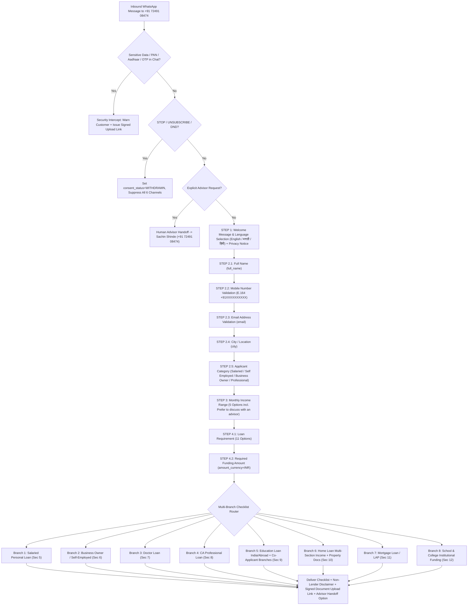

# AVANI LOAN SERVICES — CHATBOT CONVERSATION FLOW SPECIFICATION

- **Business Entity:** AVANI LOAN SERVICES (`https://www.avanifinserv.com/`)
- **Primary WhatsApp Number:** `+91 72491 08474` (WABA ID: `1062614709598311`)
- **Engine Implementation:** [`src/lib/chatbot-flow-engine.ts`](file:///c:/Users/ALPHA-1/Downloads/21MAY2026/SACHIN%20SHINDE%20DOCUMENTS/DEVELOPEMENT%20TOOLS/3-AVANI%20AI%20CRM/src/lib/chatbot-flow-engine.ts)
- **Checklist Engine:** [`src/lib/loan-checklists.ts`](file:///c:/Users/ALPHA-1/Downloads/21MAY2026/SACHIN%20SHINDE%20DOCUMENTS/DEVELOPEMENT%20TOOLS/3-AVANI%20AI%20CRM/src/lib/loan-checklists.ts)

---

## 1. Architecture Diagram (Step 1 to Step 4 + 8 Loan Branches)



---

## 2. Step-by-Step Flow Specification

### Step 1 — Welcome Message & Language Selection
- **Greeting Text:**
  ```text
  Namaste! 🙏
  Welcome to AVANI LOAN SERVICES.

  We help individuals, professionals, businesses, schools, and colleges with the right loan and funding guidance.

  Please select your preferred language to continue:
  1. English
  2. मराठी
  3. हिंदी
  ```
- **Concise Privacy Notice Displayed at Entry:**
  > *"Privacy Notice: By continuing, you consent to AVANI LOAN SERVICES processing your details for loan eligibility & advisory service (Policy vAVANI-PRIVACY-2026.2). Reply STOP anytime to opt out."*
- **Stored Variables:** `preferred_language` (`English` | `मराठी` | `हिंदी`), `consent_status = GRANTED`, `consent_timestamp`.

### Step 2 — Basic Information Collection (Strict Sequential Order)
1. **Full Name (`full_name`)**: Prompts in selected language (`What is your Full Name?` / `कृपया तुमचे पूर्ण नाव सांगा:` / `कृपया अपना पूरा नाम बताएं:`).
2. **Mobile Number (`mobile_number`)**: Validated via [`validateAndNormalizeMobile`](file:///c:/Users/ALPHA-1/Downloads/21MAY2026/SACHIN%20SHINDE%20DOCUMENTS/DEVELOPEMENT%20TOOLS/3-AVANI%20AI%20CRM/src/lib/chatbot-flow-engine.ts#L166-L176). Normalizes 10-digit Indian mobile numbers to E.164 (`+919175635165`) and ChatMitra 12-digit (`919175635165`).
3. **Email Address (`email`)**: Validated via [`validateEmailAddress`](file:///c:/Users/ALPHA-1/Downloads/21MAY2026/SACHIN%20SHINDE%20DOCUMENTS/DEVELOPEMENT%20TOOLS/3-AVANI%20AI%20CRM/src/lib/chatbot-flow-engine.ts#L178-L185).
4. **City / Location (`city`)**: Stored in `city`.
5. **Applicant Category (`applicant_type`)**:
   - `1. Salaried`
   - `2. Self Employed`
   - `3. Business Owner`
   - `4. Professional (Doctor / CA / Architect / Other)`
   - If `4. Professional` is selected, asks sub-category (`Doctor`, `Chartered Accountant (CA)`, `Architect`, `Other Professional`) and stores in `professional_subtype`.

### Step 3 — Monthly Income Range (`monthly_income_range`)
- Options presented in English, Marathi, or Hindi:
  1. `₹25,000 – ₹50,000`
  2. `₹50,000 – ₹1,00,000`
  3. `₹1,00,000 – ₹2,00,000`
  4. `Above ₹2,00,000`
  5. `Prefer to discuss with an advisor`

### Step 4 — Loan Requirement & Funding Amount
- **11 Canonical Loan Requirement Options (`loan_category`):**
  1. `Personal Loan`
  2. `Business Loan`
  3. `Home Loan`
  4. `Mortgage Loan / Loan Against Property`
  5. `Education Loan — India`
  6. `Education Loan — Abroad`
  7. `Doctor Loan`
  8. `CA Loan`
  9. `School Funding`
  10. `College Funding`
  11. `Other Loan Requirement`
- **Required Funding Amount (`required_loan_amount`):**
  - Parses numeric values, Lakhs (`L` / `लाख`), and Crores (`Cr` / `कोटी`), and enforces `amount_currency = "INR"`.

---

## 3. ChatMitra Dashboard (`/ai/chatbots`) Import Procedure
For owner Sachin Shinde when signed into `https://app.chatmitra.com/ai/chatbots`:
1. Click **Create New Chatbot** -> Name: `AVANI Loan Qualification & Checklist Bot v1`.
2. Set **Trigger**: Inbound Message on `+91 72491 08474` (when `Webhook Fallback` or `Keyword: Hi, Hello, Loan, कर्ज, लोन` is received).
3. Configure **Webhook Node** pointing to `https://avani-ai-crm.vercel.app/api/chatmitra-webhook` with header `x-webhook-signature` signed by `CHATMITRA_WEBHOOK_SECRET`.
4. Map the 20 Custom Attributes defined in [`AVANI_CHATBOT_FIELD_MAPPING.md`](file:///c:/Users/ALPHA-1/Downloads/21MAY2026/SACHIN%20SHINDE%20DOCUMENTS/DEVELOPEMENT%20TOOLS/3-AVANI%20AI%20CRM/AVANI_CHATBOT_FIELD_MAPPING.md).
