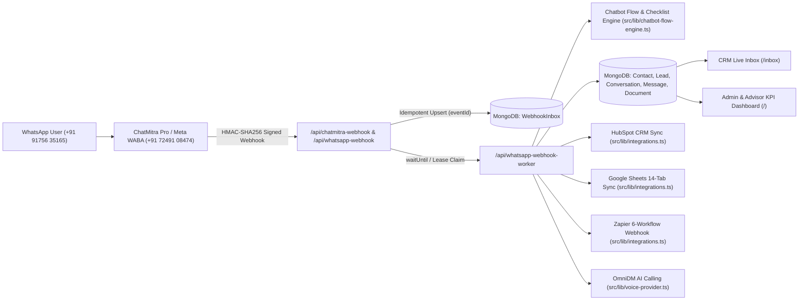

# AVANI LOAN SERVICES — CRM INTEGRATION ARCHITECTURE

- **Business Entity:** AVANI LOAN SERVICES (`https://www.avanifinserv.com/`)
- **Production CRM:** `https://avani-ai-crm.vercel.app/`
- **CRM Inbox:** `https://avani-ai-crm.vercel.app/inbox`
- **Database:** MongoDB Atlas (`MONGODB_URI` verified healthy via `/api/health`)

---

## 1. End-to-End Omnichannel Data Flow

---

## 2. Core Data Models & Deduplication Strategy

| Model | File | Primary Deduplication / Upsert Key | Key Responsibilities |
|---|---|---|---|
| **WebhookInbox** | [`src/models/WebhookInbox.ts`](file:///c:/Users/ALPHA-1/Downloads/21MAY2026/SACHIN%20SHINDE%20DOCUMENTS/DEVELOPEMENT%20TOOLS/3-AVANI%20AI%20CRM/src/models/WebhookInbox.ts) | `eventId` (unique index) | Durable queue with atomic lease locking (`PENDING` -> `PROCESSING` -> `PROCESSED` / `FAILED`) and stale-lease recovery. |
| **Contact** | [`src/models/Contact.ts`](file:///c:/Users/ALPHA-1/Downloads/21MAY2026/SACHIN%20SHINDE%20DOCUMENTS/DEVELOPEMENT%20TOOLS/3-AVANI%20AI%20CRM/src/models/Contact.ts) | `phone` (normalized 10-digit & E.164) | Stores customer identity, `isOptedOut`, `consentStatus`, `serviceConsent`, `marketingConsent`, and tags. |
| **Lead** | [`src/models/Lead.ts`](file:///c:/Users/ALPHA-1/Downloads/21MAY2026/SACHIN%20SHINDE%20DOCUMENTS/DEVELOPEMENT%20TOOLS/3-AVANI%20AI%20CRM/src/models/Lead.ts) | `phone` + `leadId` (`AVL-YYYYMMDD-XXXXXX`) | Stores qualification fields (`loanType`, `requestedAmount`, `employmentType`, `monthlyIncome`, `city`, `status`, `assignedAgent`). |
| **Conversation** | [`src/models/Conversation.ts`](file:///c:/Users/ALPHA-1/Downloads/21MAY2026/SACHIN%20SHINDE%20DOCUMENTS/DEVELOPEMENT%20TOOLS/3-AVANI%20AI%20CRM/src/models/Conversation.ts) | `leadId` / `phone` | Tracks state machine (`NEW_LEAD`, `QUALIFICATION`, `DOCUMENT_COLLECTION`, `ADVISOR_HANDOFF`, `OPTED_OUT`) and 20 custom attributes. |
| **Message** | [`src/models/Message.ts`](file:///c:/Users/ALPHA-1/Downloads/21MAY2026/SACHIN%20SHINDE%20DOCUMENTS/DEVELOPEMENT%20TOOLS/3-AVANI%20AI%20CRM/src/models/Message.ts) | `providerMessageId` / `waMessageId` | Persists inbound and outbound messages with monotonic uppercase status (`RECEIVED`, `QUEUED`, `SENT`, `DELIVERED`, `READ`, `FAILED`). |
| **Document** | [`src/models/Document.ts`](file:///c:/Users/ALPHA-1/Downloads/21MAY2026/SACHIN%20SHINDE%20DOCUMENTS/DEVELOPEMENT%20TOOLS/3-AVANI%20AI%20CRM/src/models/Document.ts) | `leadId` + `documentType` | Tracks document checklist items (`PENDING`, `UPLOADED`, `VERIFIED`, `REJECTED`) with AES-256-GCM encrypted storage references. |

---

## 3. Admin & Advisor Dashboard Architecture (Section 15)
- **API Route:** [`src/app/api/dashboard/metrics/route.ts`](file:///c:/Users/ALPHA-1/Downloads/21MAY2026/SACHIN%20SHINDE%20DOCUMENTS/DEVELOPEMENT%20TOOLS/3-AVANI%20AI%20CRM/src/app/api/dashboard/metrics/route.ts)
- **UI Component:** [`src/app/page.tsx`](file:///c:/Users/ALPHA-1/Downloads/21MAY2026/SACHIN%20SHINDE%20DOCUMENTS/DEVELOPEMENT%20TOOLS/3-AVANI%20AI%20CRM/src/app/page.tsx)
- **15 Real-Time KPIs:** Total Leads, New WhatsApp Leads Today, Qualified Leads, Leads by Loan Category, Leads by Applicant Category, Leads by City, Leads by Language, Pending Document Checklists, Partially Submitted Documents, Completed Document Packs, Leads Assigned to Advisor, Follow-up Due Today, Opted-Out Contacts, Conversion Funnel Metrics, and Campaign / Delivery Analytics.
- **7 Filter Dimensions:** Date (`dateFrom`/`dateTo`), Loan Category (`loanCategory`), City (`city`), Applicant Category (`applicantCategory`), Lead Status (`leadStatus`), Assigned Advisor (`assignedAdvisor`), and Source (`source`).
