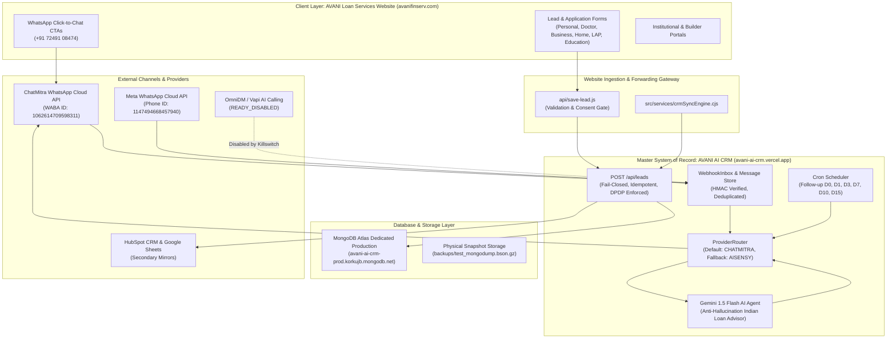

# AVANI LOAN SERVICES — MASTER AUTOMATION ARCHITECTURE

**Audit Date:** 01 November 2026  
**Execution Timestamp:** 2026-11-01T23:35:00+05:30 (Asia/Kolkata / IST)  
**Business Entity:** AVANI LOAN SERVICES  
**Production Website:** `https://www.avanifinserv.com`  
**Production CRM:** `https://avani-ai-crm.vercel.app`  
**Current Git Release Commit:** `3634744e443fd5715f7b30e338aaee07a1b13f16`  
**Published Tag:** `v1.0.1-stage1-forensic`  

---

## 1. END-TO-END AUTOMATION TOPOLOGY

The AVANI LOAN SERVICES automation architecture consists of two tightly coupled workspaces operating in an event-driven, decoupled topology:

---

## 2. CORE ARCHITECTURAL LAYERS & DATA FLOWS

### A. Lead Intake & Ingestion Pipeline
1. **Source:** Visitor submits enquiry on `https://www.avanifinserv.com` across any of 8 loan products.
2. **Client Validation:** Full 10-digit Indian mobile validation (`/^[6-9]\d{9}$/`), name, required loan amount.
3. **Consent Capture:** Explicit DPDP Act consent timestamp (`consentStatus: 'ACCEPTED'`).
4. **Ingestion Contract:** Sent via HTTPS `POST` to `https://avani-ai-crm.vercel.app/api/leads` with `x-api-key`.
5. **Deduplication:** CRM matches existing lead by normalized phone (`+91XXXXXXXXXX`) or `idempotencyKey`. If found, updates record without overwriting previous consent or history.

### B. WhatsApp Conversation & Routing Pipeline
1. **Inbound Webhook:** ChatMitra dispatches incoming WhatsApp event to `https://avani-ai-crm.vercel.app/api/chatmitra-webhook`.
2. **Security Verification:** Authenticates `x-webhook-signature` using HMAC-SHA256 with `CHATMITRA_WEBHOOK_SECRET`.
3. **Idempotency Gate:** Checks message ID against `WebhookInbox`. Replayed webhooks are acknowledged with HTTP 200 without duplicate processing.
4. **Loan Classification:** Heuristic classifier categorizes message intent into:
   - `DOCTOR_LOAN`, `BUSINESS_LOAN`, `HOME_LOAN`, `MORTGAGE_LOAN`, `EDUCATION_LOAN_INDIA`, `EDUCATION_LOAN_GLOBAL`, `PERSONAL_LOAN`, `SCHOOL_COLLEGE_FUNDING`.
5. **AI Advisor Reply:** Gemini AI agent generates context-aware, non-committal initial advice in English, Marathi, or Hindi.
6. **Outbound Dispatch:** ProviderRouter dispatches response via ChatMitra REST API using approved WhatsApp template or text message.

### C. Nurturing & Campaign Automation Lifecycle
- **D0 (Immediate):** Welcome & instant brochure link.
- **D1 (24 Hours):** Product-specific eligibility guidelines and checklist.
- **D3 (72 Hours):** Interest rate landscape and customized tenure options.
- **D7 (1 Week):** Follow-up check-in from assigned loan advisor (Sachin Shinde).
- **D10 (10 Days):** Document submission reminder and digital upload link.
- **D15 (15 Days):** Application status check & satisfaction survey.

---

## 3. DATABASE SCHEMAS & RESILIENCY

1. **Production Cluster:** `avani-ai-crm-prod.korkujb.mongodb.net` (AWS N. Virginia `us-east-1`, Replica Set: `atlas-14awhq-shard-0`).
2. **Intra-Region Latency:** Co-located in same cloud region as Vercel `iad1` (<10ms latency).
3. **Collections & Unique Constraints:**
   - `leads`: Unique index on `phone_1` and `normalizedMobile`.
   - `messages`: Unique index on `idempotencyKey_1`.
   - `system_metadata`: Unique index on `schemaVersion_1`.
   - `webhook_inbox`: Unique index on `eventId_1` and `messageId_1`.
4. **Fail-Closed Guarantee:** If database connection is not ready (`readyState !== 1`), lead intake returns HTTP 503 `DATABASE_UNAVAILABLE` to trigger upstream client retry rather than losing customer data.
