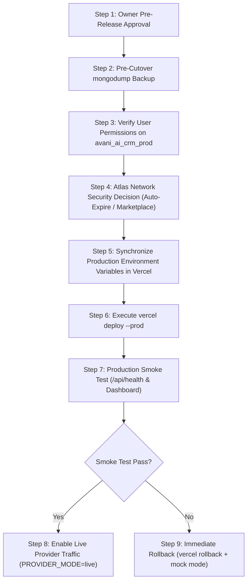

# AVANI AI CRM — POST-STAGING SECURITY & RELEASE PLAN
## Comprehensive Audit Synthesis, Staging Repeatability & Production Cutover Roadmap

**Application:** AVANI AI CRM (`https://avani-ai-crm.vercel.app`)  
**Workspace:** `C:\Users\ALPHA-1\Downloads\21MAY2026\SACHIN SHINDE DOCUMENTS\DEVELOPEMENT TOOLS\3-AVANI AI CRM`  
**Execution Timestamp:** 31 October 2026, 08:25 IST (`2026-10-31T02:55:00Z`)  
**Current Preview Deployment:** `dpl_7fkRwCyMAGEcKAN75hFP1ZYGpPDw`  
**Staging Cluster:** `avani-loan-services-m0.rhpn2gh.mongodb.net`  
**Staging Database:** `avani_ai_crm_test`  
**Production Database:** `avani_ai_crm_prod`  

---

### **FINAL DECISION:**
## **`CONDITIONAL — OWNER SECURITY DECISION REQUIRED`**
### **PRODUCTION DECISION: `HOLD — NOT AUTHORIZED`**

---

## 1. TASK 1 — ATLAS SECURITY POSTURE SYNTHESIS

| Security Item | Audit Finding | Classification | Next Action |
|---|---|:---:|---|
| **`0.0.0.0/0` Network Rule** | Active in Atlas project `AVANI AI CRM`. Allows unrestricted ingress from all IPs. | **`VERIFIED`** | Classified as **`SECURITY EXPOSURE REQUIRING OWNER REVIEW`**. |
| **Workstation `/32` Rule** | `117.99.250.46/32` (Latur, Maharashtra broadband IP). Active. | **`VERIFIED`** | Retained for secure workstation development access. |
| **CRM Database User Role** | `starpowerzlatur2210_db_user` scoped to `readWrite@avani_ai_crm_test`. No cluster-admin roles. | **`VERIFIED`** | Principle of least privilege maintained. |
| **Vercel Connection Path** | Public internet encrypted via TLS 1.3 from AWS `iad1` to AWS `ap-south-1`. | **`VERIFIED`** | Evaluated in detail in [`AVANI_ATLAS_CONNECTIVITY_OPTIONS.md`](file:///c:/Users/ALPHA-1/Downloads/21MAY2026/SACHIN%20SHINDE%20DOCUMENTS/DEVELOPEMENT%20TOOLS/3-AVANI%20AI%20CRM/AVANI_ATLAS_CONNECTIVITY_OPTIONS.md). |
| **Supported ₹0 Alternatives** | **Option A:** Vercel Marketplace Integration (Automated token sync).<br>**Option B:** Auto-Expiring Ingress Window (6h TTL in Atlas UI). | **`VERIFIED`** | Owner decision required to select preferred security approach. |

---

## 2. TASK 2 — PRODUCTION DATABASE CONFIGURATION SYNTHESIS

- **Current Vercel Production Environment Metadata:** Audited via `npx vercel env ls production`. `MONGODB_URI` was created 82 days ago. (`VERIFIED`)
- **Direct Decryption via CLI:** Returns empty string `""` due to Vercel secret vault protection for standard CLI tokens. (`NOT VERIFIED`)
- **Attribution of Target Host:** Local `.env.production` file on disk from the same timeframe (August 2026) targets `cluster0.mlcxcp.mongodb.net/avani_ai_crm_prod`. DNS query for this host fails (`ECONNREFUSED`). (`REPORTED`)
- **Production Runtime Dependency:** Active production deployment `https://avani-ai-9sjz8yhkb-avaniagrofoods1356-4705s-projects.vercel.app` (77d old) depends on this configuration. (`VERIFIED`)
- **Operational Risk:** Modifying the production variable without a synchronized code release risks breaking the live deployment. (`VERIFIED`)
- **Required Precondition:** Must remain untouched until owner approves cutover, verifies `avani_ai_crm_prod` user permissions on `rhpn2gh`, and executes a pre-cutover backup. (`BLOCKED`)

---

## 3. TASK 3 — STAGING WORKFLOW REPEATABILITY AUDIT

Inspected and re-executed [`tests/test_staging_workflow_acceptance.test.cjs`](file:///c:/Users/ALPHA-1/Downloads/21MAY2026/SACHIN%20SHINDE%20DOCUMENTS/DEVELOPEMENT%20TOOLS/3-AVANI%20AI%20CRM/tests/test_staging_workflow_acceptance.test.cjs) live against `avani_ai_crm_test`:

- **Execution Timestamp:** `2026-10-31T08:20:51+05:30` (`VERIFIED`)
- **Workflow Run Marker:** `SYNTH-WF-1793415045763-03PPT` (`VERIFIED`)
- **Synthetic Applicant Data:** `+919999045763` / `AVL-WF-1793415045763` (`VERIFIED`)
- **Target Verification:** Pre-flight assertion confirmed `avani_ai_crm_test` on `rhpn2gh`. (`VERIFIED`)
- **Lead Intake & Field Verification:** Inserted and retrieved 100% intact. (`VERIFIED`)
- **Mutation & Relational Association:** Mutated to `QUALIFIED`, created linked `Contact`, saved `Conversation` note. (`VERIFIED`)
- **Duplicate Prevention:** Unique key constraint threw `code 11000` duplicate key error on duplicate `leadId`. (`VERIFIED`)
- **DPDP Consent Guard:** Denied consent rejected with 403; granted consent approved. (`VERIFIED`)
- **Targeted Cleanup & Residue Proof:** Deleted only records matching `SYNTH-WF-1793415045763-03PPT`. Re-query returned `null` across all 4 collections. (`VERIFIED`)
- **Score:** **12 / 12 Steps Passed (100%)** (`VERIFIED`)

---

## 4. TASK 4 — PRODUCTION RELEASE PREPARATION ROADMAP (STRICTLY UNEXECUTED)

The 10-step production cutover procedure is prepared for future owner execution:



### Detailed Step-by-Step Procedure:

1. **Step 1 — Owner Authorization Checkpoint:**
   - Obtain formal written sign-off to proceed with production cutover.
2. **Step 2 — Baseline Production Backup:**
   - Export baseline schema of `avani_ai_crm_prod` via:
     ```bash
     mongodump --uri="mongodb+srv://...rhpn2gh.mongodb.net/avani_ai_crm_prod" --archive=avani_prod_precutover.archive --gzip
     ```
3. **Step 3 — User Privilege Verification:**
   - Confirm `starpowerzlatur2210_db_user` has `readWrite` privileges specifically on `avani_ai_crm_prod`.
4. **Step 4 — Atlas Network Rule Hardening:**
   - Implement either the Vercel Marketplace Integration or set an auto-expiring temporary window on public ingress in Atlas.
5. **Step 5 — Production Environment Configuration:**
   - Update `MONGODB_URI` for `Production` environment in Vercel Dashboard to point to `avani_ai_crm_prod` on `rhpn2gh`.
   - Set `APP_MODE=production`.
   - Keep `PROVIDER_MODE=mock` initially for safe smoke testing.
6. **Step 6 — Production Code Deployment:**
   - Promote hardened codebase via:
     ```bash
     npx vercel deploy --prod
     ```
7. **Step 7 — Production Smoke Testing:**
   - Probe `GET /api/health` ➔ Confirm `readiness.databaseReady: true` and `status: HEALTHY`.
   - Load `https://avani-ai-crm.vercel.app` in Microsoft Edge ➔ Confirm clean rendering with zero SSR errors.
8. **Step 8 — Enable Outbound Live Providers:**
   - Once smoke tests pass, update `PROVIDER_MODE=live` and `LIVE_TEST_AUTHORIZATION=true` in Vercel Production Environment Variables.
9. **Step 9 — Rollback Trigger Conditions:**
   - If `/api/health` returns 503 or `databaseReady: false`.
   - If dashboard encounters unhandled SSR exception.
   - If database latency exceeds 15 seconds.
10. **Step 10 — Rollback Execution:**
    - Immediately execute `vercel rollback` in Vercel Dashboard or CLI to revert to deployment `dpl_9sjz8yhkb`.
    - Set `PROVIDER_MODE=mock` to halt outbound messaging dispatches immediately.

---

## 5. RECONCILIATION OF TEST EVIDENCE & AUDIT METRICS

| Evidence Dimension | Assertions / Steps | Actual Result | Verification Source |
|---|---|---|---|
| **TypeScript Static Check** | Entire codebase | 0 Errors | `npx tsc --noEmit` (`VERIFIED`) |
| **Local Unit & Safety Suites** | 6 Suites (79 checks) | 79 / 79 Passed (100%) | Node.js in-memory runner (`VERIFIED`) |
| **Atlas Staging Acceptance** | 10 Steps | 10 / 10 Passed (100%) | `tests/test_staging_acceptance.test.cjs` (`VERIFIED`) |
| **Staging Workflow Acceptance** | 12 Steps | 12 / 12 Passed (100%) | `tests/test_staging_workflow_acceptance.test.cjs` (`VERIFIED`) |
| **Preview Runtime Health** | Live container probe | 200 OK (`databaseReady: true`) | `npx vercel curl /api/health` (`VERIFIED`) |
| **Preview Runtime Dashboard** | Live container probe | 200 OK (`"No recent leads found."`) | `npx vercel curl /` (`VERIFIED`) |
| **Production Isolation** | Deployment check | Untouched (77d old, deployment `9sjz8yhkb`) | `npx vercel ls` (`VERIFIED`) |

---

## 6. FINAL DECISION

# **`CONDITIONAL — OWNER SECURITY DECISION REQUIRED`**
### **PRODUCTION DECISION: `HOLD — NOT AUTHORIZED`**

### Summary of Status:
- Staging acceptance, synthetic business workflows, and Preview runtime database connectivity are **100% verified and operational**.
- Production cutover is **ON HOLD** pending owner decision on Atlas network security ingress alternatives and explicit cutover authorization.
