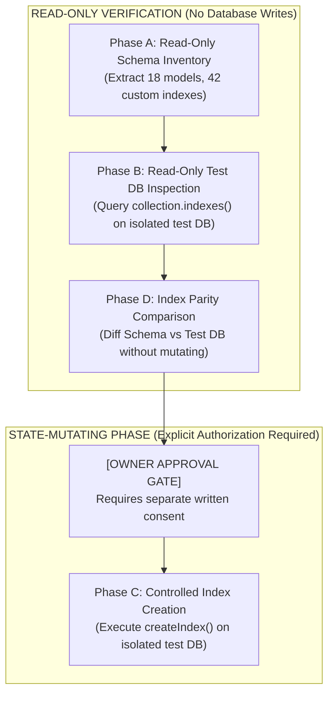

# TASK 5G.1 — INDEX WRITE AUTHORIZATION POLICY & SAFETY PROTOCOL
## DECOUPLING READ-ONLY INDEX INSPECTION FROM MUTATING INDEX CREATION

**Project:** AVANI LOAN SERVICES — ChatMitra + AVANI AI CRM  
**Date:** 18 November 2026  
**Status:** Strict Read-Only Safety Protocol  
**Authority:** Task 5G.1 Security Directive  

---

### 1. BACKGROUND & PROBLEM STATEMENT

In Task 5G, the proposed test scenario `S48` combined index inspection with active index synchronization. 

Under strict database reliability standards:
- Creating or synchronizing indexes is a **state-mutating database write operation**.
- Automating index builds without explicit, dedicated Owner authorization violates change-control boundaries.
- Using Mongoose's `syncIndexes()` is dangerous because it drops any index present in the database that is not declared in the application schema, risking silent index loss.
- Declared schema indexes (42 custom indexes in Mongoose models) must **never be assumed to match the live production database** without explicit, independent verification.

This policy permanently decomposes index testing into four isolated, non-overlapping phases and establishes strict gates for write authorization.

---

### 2. THE FOUR-PHASE INDEX SAFETY LIFECYCLE

---

### 3. DETAILED SPECIFICATION OF PHASES

#### PHASE A: READ-ONLY SCHEMA INDEX INVENTORY
- **Execution:** Offline static inspection of the 18 Mongoose models in `3-AVANI AI CRM/src/models/`.
- **Method:** `model.schema.indexes()` offline evaluation.
- **Scope:** Catalogs all 42 declared secondary/unique indexes across the 18 models.
- **Permissions Required:** Local filesystem read-only. Zero database access.
- **Mutation:** **ZERO.**

#### PHASE B: READ-ONLY TEST DATABASE INSPECTION
- **Execution:** Read-only inspection of indexes currently existing in the isolated test database `avani_ai_crm_test`.
- **Method:** `collection.indexes()` natively called via read-only driver handle.
- **Scope:** Enumerates index names, key specifications, uniqueness flags, and TTL expiration settings on each collection in `avani_ai_crm_test`.
- **Permissions Required:** `read` permission on `avani_ai_crm_test` only.
- **Mutation:** **ZERO.**

#### PHASE C: EXPLICITLY AUTHORIZED INDEX CREATION (STATE-MUTATING)
- **Status:** **PROHIBITED IN TASK 5G.1.**
- **Prerequisite:** Requires a separate, dedicated Owner Execution Authorization (e.g., Task 5H.2).
- **Execution:** Explicitly runs targeted `collection.createIndex()` or `model.init()` **ONLY** on the isolated test database.
- **Strict Prohibition:**
  - **`syncIndexes()` is STRICTLY FORBIDDEN.** `syncIndexes()` issues `dropIndex` commands for undeclared indexes.
  - **`autoIndex: true` in production is STRICTLY FORBIDDEN.**
  - **Connecting to production cluster `rhpn2gh.mongodb.net` is STRICTLY FORBIDDEN.**
- **Mutation:** Creates indexes in `avani_ai_crm_test` only.

#### PHASE D: INDEX PARITY VERIFICATION
- **Execution:** Mathematical set comparison comparing Phase A (declared schema indexes) with Phase B/C (actual test database indexes).
- **Formula:**
  $$\text{Missing Indexes} = \text{Schema Indexes} \setminus \text{Test DB Indexes}$$
  $$\text{Extra Indexes} = \text{Test DB Indexes} \setminus \text{Schema Indexes}$$
- **Pass Criteria:** $\text{Missing Indexes} = \emptyset$.
- **Permissions Required:** Read-only analysis.
- **Mutation:** **ZERO.**

---

### 4. CORE REVISED RULES FOR TEST SCENARIO S48

Under the revised test plan:
1. **Scenario S48 is re-scoped to Phase A, Phase B, and Phase D only.**
2. When S48 runs initially against a freshly provisioned test database:
   - S48 inspects the collections and expects only default `_id_` indexes to be present.
   - S48 accurately reports missing secondary indexes without attempting to create them.
   - S48 passes verification that read-only inspection functions correctly.
3. Index creation (Phase C) can only be triggered after the Owner reviews the S48 inspection report and issues explicit authorization to create the indexes on the test cluster.

---

### 5. PRODUCTION INDEX ISOLATION SAFEGUARD

To ensure production stability:
- **No Production Probing:** Antigravity and the CRM test runners must never connect to `rhpn2gh.mongodb.net` or `avani_ai_crm_prod` to inspect or compare production indexes.
- **Baseline Document Reference:** Production index parity is established solely via offline reference to `CP26_6_INDEX_PARITY.csv`, which was pre-compiled and signed off during Checkpoint 26.6.
- **Hard Fail-Closed:** If any index inspection tool receives a connection string containing `rhpn2gh` or database name `avani_ai_crm_prod`, it must throw `PRODUCTION_CLUSTER_FORBIDDEN_IN_NON_PROD` and abort immediately.
