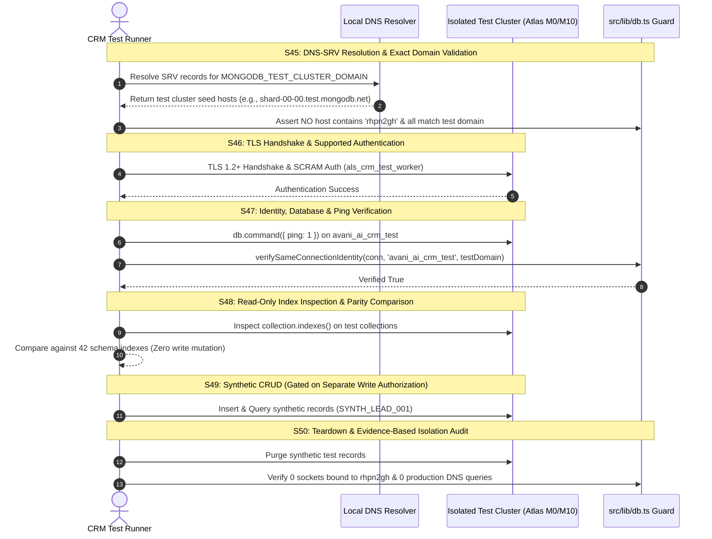

# TASK 5G.1 — REVISED S45–S50 LIVE INTEGRATION TEST PLAN
## ISOLATED ATLAS VERIFICATION WITHOUT PRODUCTION CROSS-CONTAMINATION

**Project:** AVANI LOAN SERVICES — ChatMitra + AVANI AI CRM  
**Date:** 18 November 2026  
**Status:** Read-Only Test Plan Specification (Not Authorized for Execution)  
**Authority:** Task 5G.1 Architectural Revision  

---

### 1. REVISION PRINCIPLES

This revised test plan corrects all procedural and security assumptions from Task 5G:
1. **Tier-Supported Authentication:** S46 tests authentication using the mechanism supported by the selected cluster tier (`SCRAM-SHA-1` for M0, or `SCRAM-SHA-256` for M10).
2. **Read-Only Index Inspection:** S48 performs strictly read-only inspection of declared schema indexes vs. existing test database indexes. Index creation is decoupled and gated on separate Owner approval.
3. **Write-Gated Synthetic CRUD:** S49 executes only after explicit Owner database-write approval.
4. **Purely Synthetic Test Data:** Strictly uses reserved synthetic identifiers (`SYNTH_LEAD_001`, `+919999900001` through `+919999900005`). Zero real customer data or phone numbers.
5. **Evidence-Based Isolation Verification:** S50 proves that the production database was untouched without ever connecting to the production cluster.

---

### 2. REVISED SCENARIO SPECIFICATIONS (S45 – S50)

---

### 3. STEP-BY-STEP TEST DEFINITIONS

#### SCENARIO S45 — DNS-SRV RESOLUTION & EXACT HOSTNAME VALIDATION
- **Goal:** Verify that the configured test cluster domain resolves to valid MongoDB Atlas nodes and matches `MONGODB_TEST_CLUSTER_DOMAIN` exactly.
- **Preconditions:** `NODE_ENV=test`, `APP_MODE=test`, `MONGODB_TEST_CLUSTER_DOMAIN` set to exact provisioned test cluster FQDN.
- **Actions:**
  1. Resolve DNS SRV records for `_mongodb._tcp.${MONGODB_TEST_CLUSTER_DOMAIN}`.
  2. Parse all returned hostnames.
  3. Validate that every hostname matches the suffix `.${MONGODB_TEST_CLUSTER_DOMAIN}`.
  4. Assert that **zero** resolved hostnames contain `rhpn2gh` or any production seed.
- **Pass Criteria:** All seed hosts belong strictly to the test cluster. No production hostnames present.

#### SCENARIO S46 — TLS 1.2+ & TIER-SUPPORTED AUTHENTICATION
- **Goal:** Establish a secure TLS connection and authenticate database user `als_crm_test_worker`.
- **Mechanism Selection:**
  - If **Option A (M0 Free Tier):** Uses `authMechanism=SCRAM-SHA-1`.
  - If **Option B (M10 Dedicated):** Uses `authMechanism=SCRAM-SHA-256`.
- **Actions:**
  1. Initialize Mongoose 9.7 connection using test connection string.
  2. Validate TLS 1.2+ handshake negotiation.
  3. Authenticate user `als_crm_test_worker` against `avani_ai_crm_test`.
- **Pass Criteria:** TLS session established; authentication succeeds without fallback errors.

#### SCENARIO S47 — ACTUAL CONNECTION IDENTITY & PING VERIFICATION
- **Goal:** Verify that the live connection is bound to `avani_ai_crm_test` and topology nodes belong to the test cluster.
- **Actions:**
  1. Execute `await connection.db.command({ ping: 1 })`.
  2. Invoke `verifySameConnectionIdentity(connection, 'avani_ai_crm_test', MONGODB_TEST_CLUSTER_DOMAIN)`.
  3. Assert `nativeClient.topology.description.servers` contains only test cluster nodes.
- **Pass Criteria:** Ping returns `{ ok: 1 }`; connection identity verification returns `verified: true`.

#### SCENARIO S48 — READ-ONLY INDEX INSPECTION & PARITY COMPARISON
- **Goal:** Inspect indexes on the isolated test database and compare against the 18 Mongoose models without mutating database state.
- **Actions:**
  1. Enumerate all 18 models offline and extract the 42 declared custom indexes (Phase A).
  2. For each collection in `avani_ai_crm_test`, call `collection.indexes()` (Phase B).
  3. Compute missing and surplus index sets without invoking `syncIndexes()` or `createIndex()` (Phase D).
- **Pass Criteria:** Read-only inspection completes successfully. Discrepancies reported as telemetry without write errors.

#### SCENARIO S49 — SYNTHETIC CRUD EXECUTION (WRITE-GATED)
- **Goal:** Exercise basic Create, Read, Update, and Delete operations using strictly synthetic fixtures.
- **Prerequisite:** Explicit Owner database-write authorization.
- **Fixtures Policy:**
  - Identifiers: `SYNTH_LEAD_001`, `SYNTH_ADVISOR_001`, `SYNTH_CONTACT_001`.
  - Phone Numbers: `+919999900001` to `+919999900005` (Indian telecom reserved test block).
  - PII: All names, emails, and PAN values are fake mock literals (e.g., `Test User Alpha`, `test.alpha@example.invalid`, `ABCDE1234F`).
- **Actions:**
  1. Insert synthetic lead document into `leads` collection.
  2. Query document by synthetic phone number.
  3. Update lead status to `CONTACTED`.
  4. Soft-delete or mark synthetic document.
- **Pass Criteria:** Full CRUD lifecycle succeeds; zero schema validation rejections.

#### SCENARIO S50 — TEST-SIDE TEARDOWN & EVIDENCE-BASED ISOLATION AUDIT
- **Goal:** Clean up test data and verify that the production cluster was completely untouched.
- **Critical Isolation Rule:** **NEVER connect to production to prove it was untouched.**
- **Actions:**
  1. Delete all synthetic documents created during S49 in `avani_ai_crm_test`.
  2. Audit test runner connection logs, socket descriptors, and DNS caches.
  3. Verify that zero network packets were addressed to `rhpn2gh.mongodb.net` or its resolved IP addresses.
  4. Verify that `PROD_CLUSTER_HOST` was never resolved or connected.
- **Pass Criteria:** Test database returns to baseline state; audit log conclusively confirms zero production network activity.

---

### 4. SUMMARY OF GATED DEPENDENCIES

| Scenario | Execution Classification | Gated Dependency |
| :---: | :--- | :--- |
| **S45** | Network Read (DNS only) | Task 5H.1 Provisioning (Test Domain Configured) |
| **S46** | Network Read/Auth Handshake | Task 5H.1 Provisioning (Test Cluster Running) |
| **S47** | Database Read (Ping only) | S46 Success |
| **S48** | Database Read (Index metadata) | S47 Success |
| **S49** | Database Write/Mutating CRUD | **Explicit Owner Database-Write Authorization** |
| **S50** | Database Write/Teardown | S49 Completion |
