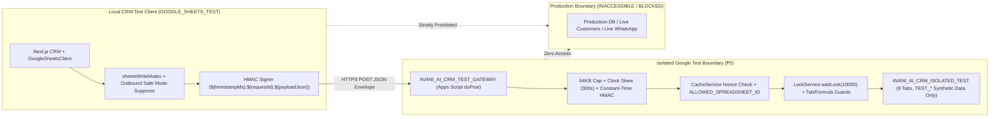

# TASK 5H.9 — ISOLATED TEST ARCHITECTURE
**Proposed Environment:** `GOOGLE_SHEETS_TEST` (100% Isolated from Production)

---

## 1. Proposed Naming & Isolation Convention (Not Created Yet)
- **Test Spreadsheet:** `AVANI_AI_CRM_ISOLATED_TEST`
- **Apps Script Project:** `AVANI_AI_CRM_TEST_GATEWAY` (bound to `AVANI_AI_CRM_ISOLATED_TEST`)
- **Synthetic Record Prefixes:** `TEST_CUST_`, `TEST_AVL_`, `TEST_APP_`, `TEST_FUP_`, `TEST_EVENT_`
- **Test Secret Scope:** Dedicated test-only `GOOGLE_SHEETS_GATEWAY_SECRET` (>=32 chars, never shared with production)

## 2. Isolated Architecture Diagram

