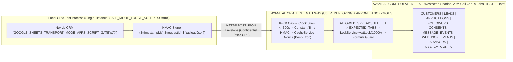

# TASK 5H.10 — CORRECTED TEST ENVIRONMENT ARCHITECTURE
**Corrected Specs:** 20M-cell workbook limit (`support.google.com/drive/answer/37603`), `SpreadsheetApp` quotas (`6 min/exec`, `30 simultaneous/user`, `50k Properties/day`), and `USER_DEPLOYING` + `ANYONE_ANONYMOUS` access model (isolated test only).

