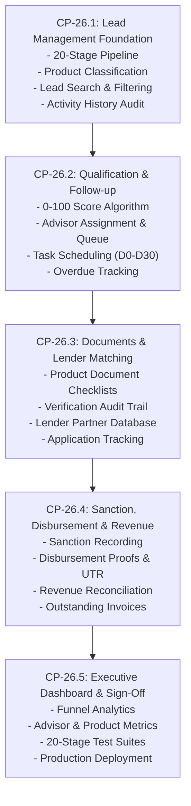

# AVANI LOAN SERVICES — CP-26 IMPLEMENTATION PLAN
## LEAD-TO-REVENUE OPERATIONS, CRM AUTOMATION & CONVERSION MANAGEMENT

**Project:** AVANI LOAN SERVICES — AVANI AI CRM  
**Workspace:** `3-AVANI AI CRM`  
**Production URL:** https://avani-ai-crm.vercel.app  
**Owner & Chief Loan Advisor:** Sachin Shinde (`enquiry@avanifinserv.com`)  
**Created:** 2026-11-10T21:30:00+05:30  
**Baseline Milestone:** CP-25.3.3 (Commit `c72ab79`, Deployment `dpl_GNqXYSJPvzUSpx3fjikrfbM2RwbM`)  

---

## 1. ARCHITECTURAL OVERVIEW & OBJECTIVES

Transform AVANI AI CRM into an end-to-end Loan Lead Management & Revenue Operations Operating System covering the complete lifecycle:
```
Enquiry (WhatsApp/Web/Manual)
   ↓
Lead Capture & Deduplication (Canonical Lead ID, Phone Normalization)
   ↓
Product Classification (Doctor, Personal, Business, Home, LAP, Education, Institutional)
   ↓
Qualification Engine (0–100 Transparent Score Breakdown)
   ↓
Advisor Assignment (Unassigned Queue, Manual/Round-Robin Ownership)
   ↓
Follow-Up & Reminder Engine (D0 to D30 Structured Task Schedules)
   ↓
Document Collection & Verification (Category-Specific Checklists, Secure Audit)
   ↓
Lender Matching & Application Tracking (Partner Banks/NBFCs, Application Ref)
   ↓
Sanction Tracking (Sanction Letter, Sanctioned Amount, Terms)
   ↓
Disbursement Tracking (Disbursed Amount, UTR/Proof, Dates)
   ↓
Revenue Tracking & Reconciliation (Expected vs Actual Collected Revenue, Invoices)
   ↓
Executive Lead-to-Revenue Dashboard (Funnel Analytics, Advisor & Product Performance)
```

---

## 2. PRODUCTION SAFEGUARDS (PRESERVED UNCHANGED)

| Invariant / Flag | Enforced Setting | Operating Behavior |
| :--- | :--- | :--- |
| `PROVIDER_MODE` | `mock` | Protects against unapproved outbound dispatch costs. |
| `CHATMITRA_INBOUND_AUTO_REPLY_ENABLED`| `false` | CRM AI worker does not duel with ChatMitra chatbot. |
| `BULK_BROADCAST_ENABLED` | `false` | Bulk marketing disallowed without explicit owner consent. |
| `AUTHORIZED_TEST_PHONE_CANONICAL` | `919175635165` | Restricts live testing strictly to authorized contact. |
| **Sole Automated WhatsApp Chatbot** | ChatMitra Visual Bot | Active on ChatMitra platform over official WABA `+91 72491 08474`. |
| **CRM Inbound Persistence** | Active | Inbound messages saved to MongoDB Atlas & CRM Inbox. |
| **Human Supervision** | Mandatory | Human advisors maintain complete oversight. |

---

## 3. STAGED IMPLEMENTATION ROADMAP



---

## 4. DATABASE & MODEL DESIGN

### 4.1 Schema Migration (`src/models/Lead.ts` Extensions)
Preserve all existing fields and data. Add optional structured fields:
- `stage`: 20 canonical stages enum.
- `stageHistory`: Array of `{ stage, changedBy, changedAt, reason, notes }`.
- `productDetails`: Conditional fields for Doctor, Business, Home, LAP, Education, School/College.
- `qualificationScore`: 0–100 integer.
- `qualificationBreakdown`: `{ contactability, clarity, amountPurpose, incomeFinancials, docReadiness, responsiveness, followUpEngagement, calculatedAt }`.
- `assignedAdvisor`: `{ id, name, email, role, assignedAt }`.
- `assignmentHistory`: Array of `{ advisorName, advisorEmail, assignedBy, assignedAt, notes }`.
- `followUpTasks`: Array of `{ taskId, title, dueDate, priority, status, notes, completedAt, completedBy }`.
- `application`: `{ lenderId, lenderName, applicationNumber, appliedAmount, submissionDate, status, notes }`.
- `sanction`: `{ sanctionedAmount, sanctionDate, sanctionLetterRef, conditions, status }`.
- `disbursement`: `{ disbursedAmount, disbursementDate, proofRef, utrNumber, status }`.
- `revenue`: `{ agreedCommissionPct, agreedConsultancyFee, expectedRevenue, actualRevenueReceived, paymentDate, paymentStatus, invoiceNumber, outstandingAmount }`.

### 4.2 Supporting Models
- `src/models/Lender.ts`: Managing partner banks/NBFCs (SBI, HDFC, ICICI, Axis, Bajaj Finserv, Tata Capital, Poonawalla, etc.).
- `src/models/Advisor.ts`: Advisor profiles (Sachin Shinde as Chief Loan Advisor, plus operational advisors).

---

## 5. API ROUTES ARCHITECTURE

| Route | Methods | Purpose |
| :--- | :--- | :--- |
| `/api/leads` | GET, POST | Search, filter (20 stages, product, advisor, city), and create lead with deduplication. |
| `/api/leads/[id]` | GET, PATCH | Retrieve lead details, update stage with history, update product specifics. |
| `/api/leads/[id]/qualify` | POST | Calculate & persist 0–100 qualification score with breakdown. |
| `/api/leads/[id]/assign` | POST | Assign lead to an advisor and log assignment history. |
| `/api/leads/[id]/tasks` | GET, POST, PATCH | Manage follow-up tasks (D0–D30 schedules, status, notes). |
| `/api/leads/[id]/application` | POST, PATCH | Submit application to lender, record sanction, disbursement, and revenue. |
| `/api/lenders` | GET, POST | List and manage partner lending institutions. |
| `/api/advisors` | GET, POST | List and manage advisor profiles and workloads. |
| `/api/dashboard/metrics` | GET | Comprehensive pipeline, outcome, advisor, product, and revenue analytics. |

---

## 6. UI & UX COMPONENTS

1. **Leads Page (`/leads`):**
   - 20-Stage interactive Kanban & table views with quick filters (Stage, Product, Advisor, City).
   - Search bar (Lead ID, Name, Phone).
   - Lead detail drawer / modal with full activity timeline, stage changer, qualification calculator, document checklist, and application tracker.
2. **Dashboard (`/` or `/crm`):**
   - Executive KPIs: Total Leads, Contacted, Qualified, In Review, Sanctioned, Disbursed, Revenue Collected.
   - Conversion rates (Lead -> Application, Application -> Sanction, Sanction -> Disbursement).
   - Overdue follow-up task alerts.
   - Product-wise and advisor-wise revenue distributions.
3. **Sidebar Updates:**
   - Ensure clean navigation for Dashboard, Leads, Contacts, Inbox, Lenders, and Tasks.

---

## 7. VERIFICATION & ACCEPTANCE CRITERIA

1. Execute test suites covering all 20 stages and operational flows.
2. Verify zero-regression against existing 20 CP-25 suites (305 tests).
3. Test 7 real-world scenarios:
   - Case A: Doctor Loan enquiry from WhatsApp.
   - Case B: Business Loan enquiry with incomplete financials.
   - Case C: Home Loan lead with documents pending.
   - Case D: School Funding requiring advisor qualification.
   - Case E: Application submitted to lender.
   - Case F: Loan sanctioned but not disbursed.
   - Case G: Loan disbursed with actual revenue collected.
4. Verify deployment to Vercel production with zero secret leaks.
